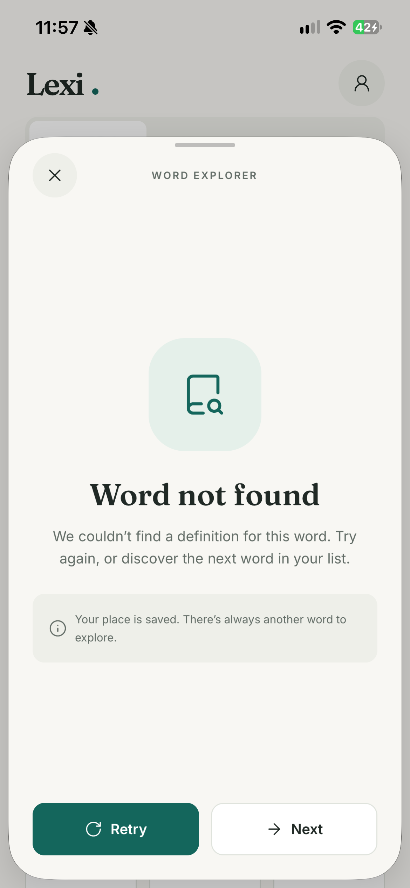
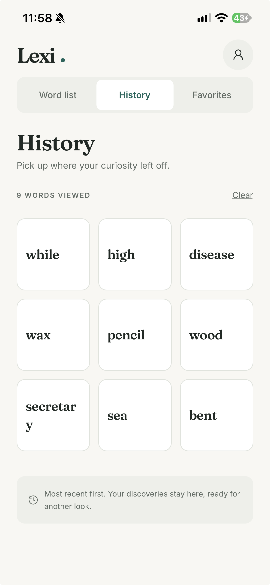
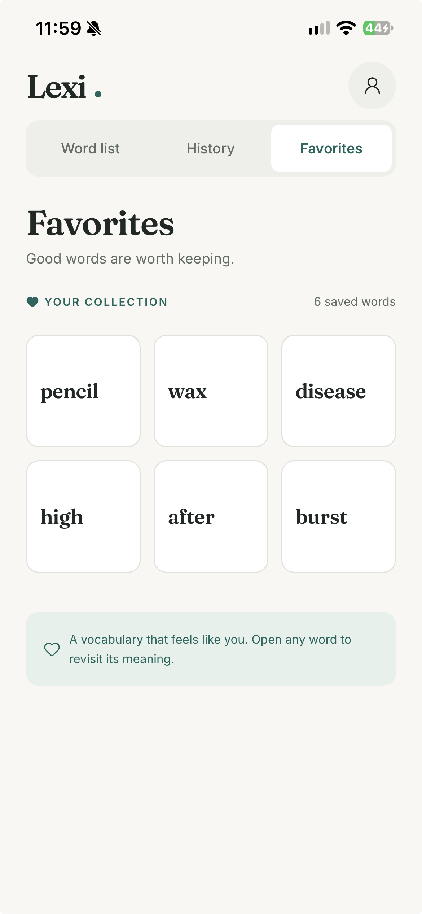
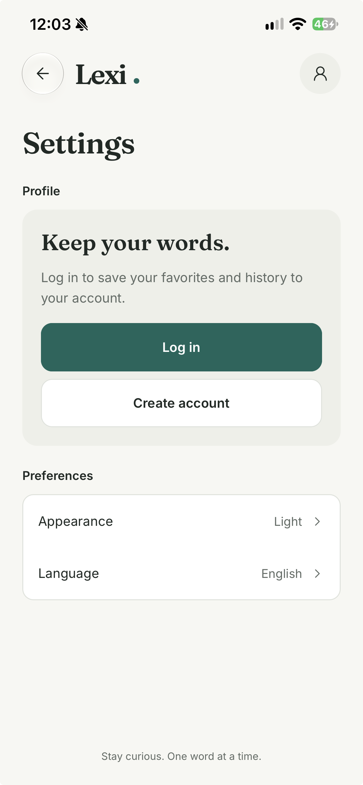
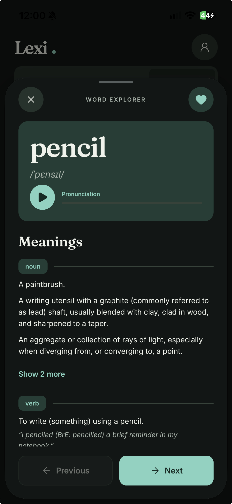

# Lexi

[](https://github.com/EnzoFelyx/lexi-mobile-challenge/actions/workflows/ci.yml)

[Português](README.md) · **English**

An English dictionary for Android and iOS: browse words with infinite scroll, see meanings and phonetics, listen to the pronunciation, and keep favorites and a viewing history.

> This is a challenge by [Coodesh](https://coodesh.com/)

## Demo

🎬 **Demo video:** [watch the video](COLE_AQUI_O_LINK_DO_VIDEO)

<p align="center">
  
  <br />
  <em>Full flow: list, detail, audio, favorite, history and login.</em>
</p>

| | | | |
| --- | --- | --- | --- |
| <br />**Login:** email and password, or guest | <br />**Word list:** infinite scroll grid | <br />**Detail:** phonetics, audio and meanings | <br />**No result:** Retry and Next |
| <br />**History:** viewed words | <br />**Favorites:** saved words | <br />**Settings:** account, theme and language | <br />**Dark theme:** word detail |

## What the app does

**Challenge requirements**

- A list of 370,000 words with infinite scroll, in a 3-column grid.
- Word detail with meanings and phonetics, and Previous/Next within the source list.
- Save and remove favorites.
- A list of viewed words.
- Response cache: a word already looked up opens instantly, even offline and after closing the app.

**Challenge differentials**

- Audio player, with the device voice when the API has no mp3.
- Dependency injection with tsyringe.
- Unit and component tests.
- Login with favorites and history linked to the user ID.

**Extras**

- Light and dark themes, and an English or Portuguese interface.
- Guest mode, with no account and no connection.
- Detail shortcuts: double tap to favorite and swipe to change words.

## Technologies

| Area | Choice |
| --- | --- |
| App | React Native 0.88 + TypeScript (`strict`), Expo SDK 58, Expo Router |
| Styling | NativeWind 4 (Tailwind 3) with tokens taken from the Figma design, light and dark themes |
| Navigation | Expo Router: top tabs (`TopTabs`) with a custom tab bar, word detail as a native form sheet |
| Dependency injection | tsyringe |
| Tests | Jest (`jest-expo`) + React Native Testing Library |
| Quality | ESLint + Prettier, with rules against hardcoded colors and `any`; GitHub Actions on every push |
| Fonts and icons | Fraunces and Inter (Google Fonts), Lucide |
| Local data | SQLite (`expo-sqlite`) + Drizzle ORM, rows validated with Zod, TanStack Query |
| Lists | FlashList (3-column grid with infinite scroll and a fast scrollbar) |
| Pronunciation | `expo-audio` (API mp3, cached with `expo-file-system`) and `expo-speech` (device voice as fallback) |
| Account | Zustand, Supabase (auth and sync, with RLS) |

## How to run

Requirements: [Node.js](https://nodejs.org/) 22.13 or newer and the **Expo Go** app (SDK 58) on an Android or iOS device.

**1. Install the project:**

```bash
git clone https://github.com/EnzoFelyx/lexi-mobile-challenge.git
cd lexi-mobile-challenge
npm install
```

**2. To test the login, create a `.env` file at the root with this content:**

```bash
EXPO_PUBLIC_SUPABASE_URL=https://fyefcdlvxjvepapyqyvr.supabase.co
EXPO_PUBLIC_SUPABASE_PUBLISHABLE_KEY=sb_publishable_DJVAHqPRbgFKmGVm9mMZUQ_LAXW1eT5
```

This key is public by design: it identifies the project, and RLS ensures that each user can only access their own data. Create an account with any email, since there is no confirmation. Without the `.env`, the app works normally, but only as a guest.

**3. Start the app:**

```bash
npx expo start
```

Scan the QR code with the camera (iOS) or with Expo Go (Android). The phone and the computer must be on the same network; otherwise use `npx expo start --tunnel`.

The first launch needs internet to download the word list, which only happens once.

### Using your own Supabase

The project above is on the free plan, which can be paused for inactivity. If that happens, login is unavailable and the rest of the app keeps working. To use your own project:

1. Create a project on [Supabase](https://supabase.com/) and run the file in [`supabase/migrations/`](supabase/migrations/) in the SQL Editor.
2. Under **Authentication**, turn off email confirmation.
3. Copy `.env.example` to `.env` and fill in the project URL and publishable key (**Connect** button on the dashboard). Never use the `secret` or `service_role` key.
4. Restart with `npx expo start -c`.

### Scripts

| Command | What it does |
| --- | --- |
| `npm start` | Starts the dev server (Expo Go) |
| `npm run lint` | ESLint + Prettier |
| `npm run typecheck` | TypeScript type checking |
| `npm test` | Unit and component tests |
| `npm run format` | Formats the code with Prettier |
| `npm run db:generate` | Generates the local database migrations from the schema |

## Tests and verification

- **Tests:** 423 tests in 89 suites, run by CI on every push, along with lint and type checking. The repositories use real SQL, on an in-memory SQLite database.
- **Statement coverage:** `domain` 99.0%, `data` 93.7% and 87.6% for the project. The thin native module adapters (audio and voice) are left untested on purpose.
- **RLS:** tested directly on the server with two users, on `favorites` and `history`: all 28 checks passed.
- **Devices:** checked on an iPhone with iOS 26, a current Android emulator and a physical Android 12 device.
- **No E2E tests:** the challenge asks for unit or E2E tests, and the deadline went to unit and component tests.

## Design

The screens started from this [Figma file](https://www.figma.com/design/2SH7Dc3Qpr9ZjIw0iv8GGv/Untitled?node-id=0-1) (light and dark versions, loading and error states, and a component showcase), and the interface follows the challenge wireframe. Where the app differs from the Figma on purpose, the reason is recorded in [`CLAUDE.md`](CLAUDE.md).

The Figma layout was adapted while the app screens were being built, for a better user experience. Where they differ, the app is the reference.

## Navigation and interaction

Small changes to make moving through words and using the app faster and more predictable. People who study vocabulary go through many words in a row, so the Figma buttons stay as the main (and accessible) path, and a few shortcuts sit on top of them:

- **Previous/Next in every tab.** The word detail walks the list of the tab it was opened from: Word list, History or Favorites. History and Favorites keep the order the user saw while the detail is open, so opening a word (which moves it to the top of the history) or unfavoriting it does not make "Next" skip words.
- **Clear the history** from the History tab, always after a confirmation.
- **Double tap to favorite**, like a social media post. A double tap anywhere on the word card or its meanings toggles the favorite, just like the heart on the toolbar. Saving shows a heart in the middle of the screen; removing only updates the toolbar heart. Buttons inside the detail (play, "Show more") keep their own taps, and screen reader users keep the toolbar heart.
- **Swipe sideways to change words.** On the detail, a horizontal swipe goes to the next word (left) or the previous one (right), in the same list as Previous/Next. It triggers with a short swipe and does not move the screen; diagonal drags are ignored, so scrolling the meanings and closing the sheet work as before.

## Architecture

Folders by feature, with layers inside each one. The UI only knows the `domain` interfaces; the DI container picks the implementation.

```text
src/
  app/        # Expo Router routes (thin: they only compose screens)
  features/   # words, favorites, history, auth, sync, settings → domain / data / hooks / components
  core/       # theme (Figma tokens), DI container, database and Supabase clients
  shared/     # reusable components, hooks and utils
  i18n/       # all UI strings, in English and Portuguese
  constants/  # named values (page size, sheet height…)
```

## Process and decisions

The challenge asks for the investigation process and the decisions to be documented. This repository was created from the [Coodesh challenge template](https://github.com/coodesh/mobile-challenge-20240202); the original description is kept in [`CHALLENGE.md`](CHALLENGE.md), with the [wireframe](img/wireframe.png). The process lives in versioned files (in Portuguese):

- [`CLAUDE.md`](CLAUDE.md): project context, challenge requirements, every decision with its date and reason, design tokens, stack and architecture.
- [`REGRAS.md`](REGRAS.md): code rules (layers, DI, centralized theme, safe async calls, no duplication).
- [`todo.md`](todo.md): roadmap split into stages, each with its "done when" criteria.
- [`CHANGELOG.md`](CHANGELOG.md): what changed in each stage, with the commit hashes.

The main decisions:

- **Common words first, in a random but stable order.** In alphabetical order the list would start with "a", "aa", "aaa"…, and the dwyl file is full of rare words missing from the API. Like the wireframe (hello, today, great…), the list opens with Ogden's Basic English, then the most frequent English words, then the rest. Each word gets a random sort key inside its group when the list is stored, so the order varies but stays the same between sessions.
- **Words without a result stay in the list.** The API's 404 is not always final: "every" once returned 404 from a CDN cache. So the card is only dimmed, the stored answer lasts 7 days, and the screen offers Retry and Next.
- **Login as the first screen, but optional.** The first screen is the login, which presents the account feature, with the option to continue as a guest in one tap: no use case requires an account. The choice is saved, and the app goes straight to the list on later openings.
- **Email and password instead of "username and password".** The email plays the role of the username, and it is what Supabase Auth offers. There is no social login, because the challenge does not ask for it and the login redirect differs between Expo Go and the compiled app. There is no email confirmation either, so the evaluator can create an account and log in right away.
- **Local-first with sync.** Favorites and history always go through SQLite. On login, the guest data is merged into the account: favorites by union and, in the history, the latest visit of each word wins. Each change enters a local queue and is sent when there is a connection, so the app stays usable offline.
- **When logging out,** the person stays in the app as a guest, and the account data leaves the device once it has been sent. It comes back on the next login, and someone else on the same phone cannot see it.
- **Runs on Expo Go.** No custom native code, so the evaluator can test on iOS without a paid Apple account.
- **English interface by default, with a Portuguese option.** The challenge wireframe mixes languages (tabs and "Meanings" in English, "Voltar/Próximo" in Portuguese). Since every definition, example and part of speech from the Free Dictionary API is in English, the default is English, for consistency; "Previous/Next" keep the wireframe's function. Settings can switch the app's own texts to Portuguese; the API content stays in English.
- **Full-screen detail below Android 13.** The native sheet did not open on a real Android 12 device, so below Android 13 the detail opens as a modal.
- **Accessibility.** WCAG AA contrast is checked by a test on every color pair, and the light secondary text was slightly darkened from the Figma value to pass on the tab rail. The system font scales up to 200% (130% in the header, tabs and detail toolbar), and the app respects "Reduce motion".

## Known limits

- **Free Dictionary API:** it limits requests per IP. When the limit is reached, the app shows its own message and does not retry by itself. The audio server can also be down; in that case, the device voice takes over.
- **Android 12:** the reason the native sheet does not open was not identified; the full-screen detail works around it.
- **Logging out with no connection:** the app tries to send the data for up to 3 seconds. If it cannot, the data stays on the device, hidden from everyone, and is sent on that account's next login.
- **Fast scrollbar:** it only covers the words already loaded; dragging to the end loads the next page as normal scrolling does.
- **Android with gesture navigation:** swiping from the screen edge is the system "back" and closes the detail; starting in the middle of the content changes the word.
- **iOS 26:** the detail sheet grows a little when touched. This is system behavior, with no option to turn it off.
- **Splash:** Expo Go shows its own loading screen; the Lexi splash only appears in the compiled app.
- **Touch target:** the minimum is 44pt, as in the Figma, below the 48dp recommended on Android.

## Credits

- Word list: [dwyl/english-words](https://github.com/dwyl/english-words) (`words_dictionary.json`).
- Common words at the top of the list: [Ogden's Basic English](https://simple.wikipedia.org/wiki/Wikipedia:BASIC_English_alphabetical_wordlist) (public domain) and [google-10000-english](https://github.com/first20hours/google-10000-english) (educational use), built by `scripts/build-common-words.mjs`.
- Definitions, phonetics and audio: [Free Dictionary API](https://dictionaryapi.dev/).
- Fonts: [Fraunces](https://fonts.google.com/specimen/Fraunces) and [Inter](https://fonts.google.com/specimen/Inter), under the SIL Open Font License 1.1.
- Icons: [Lucide](https://lucide.dev/).
