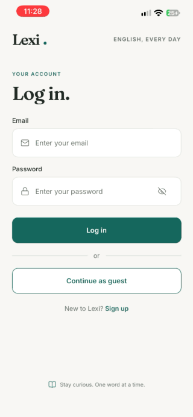
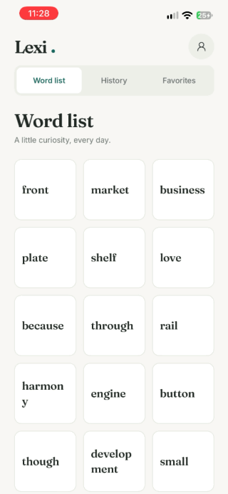
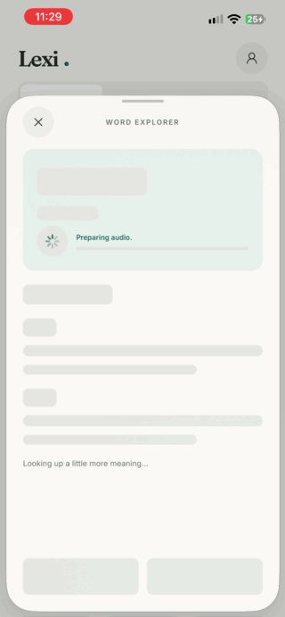
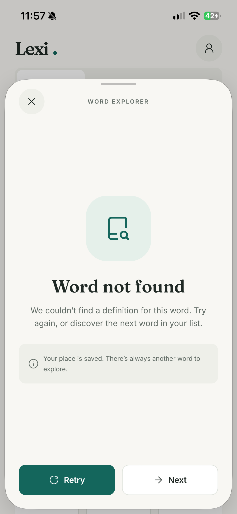
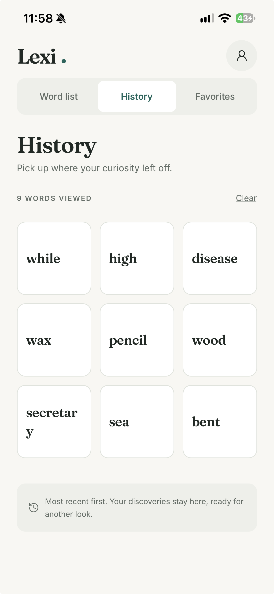
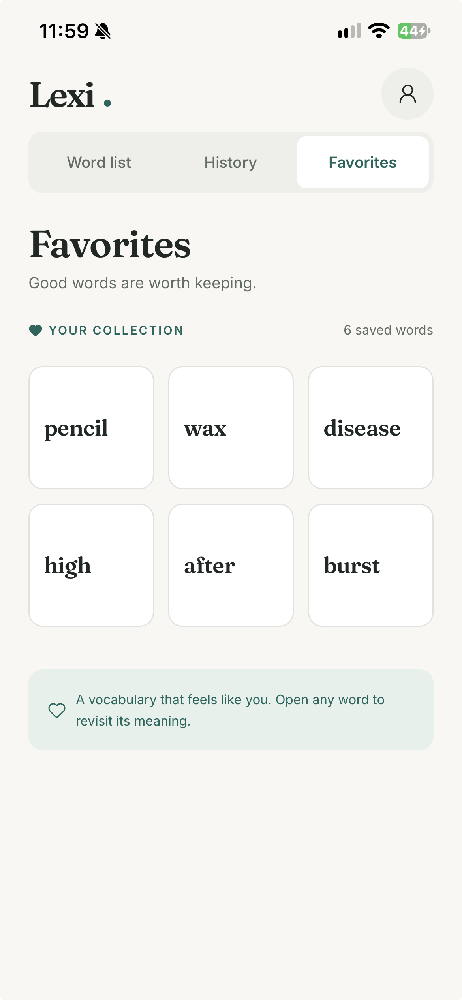
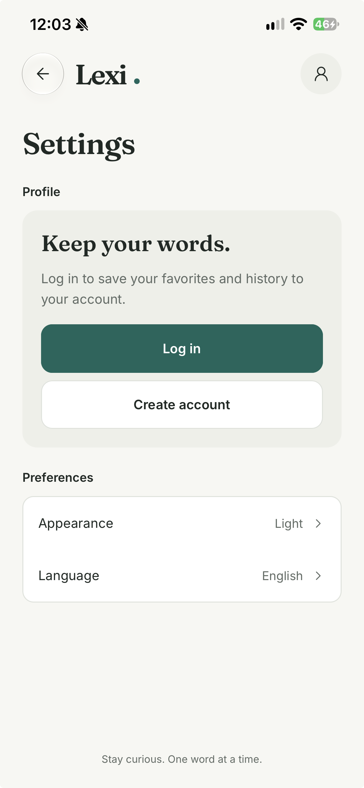
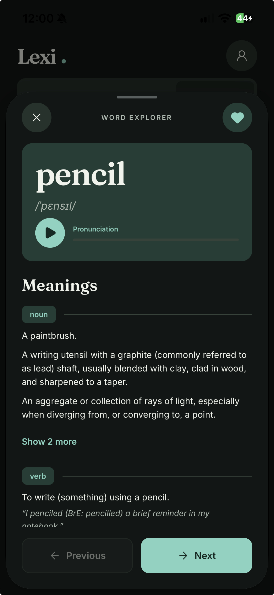

# Lexi

[](https://github.com/EnzoFelyx/lexi-mobile-challenge/actions/workflows/ci.yml)

**Português** · [English](README.en.md)

Um dicionário de inglês para Android e iOS: navegue pelas palavras com rolagem infinita, veja significados e fonética, ouça a pronúncia e guarde favoritos e o histórico de palavras vistas.

> This is a challenge by [Coodesh](https://coodesh.com/)

## Demonstração

Clique aqui para [assistir](https://www.youtube.com/watch?v=3GnNPClID0k)

<table>
  <tr>
    <td width="25%" valign="top">
      <br />
      <strong>Login e cadastro:</strong> validação dos campos, ou visitante
    </td>
    <td width="25%" valign="top">
      <br />
      <strong>Word list:</strong> grade com rolagem infinita
    </td>
    <td width="25%" valign="top">
      <br />
      <strong>Detalhe:</strong> fonética, áudio e significados
    </td>
    <td width="25%" valign="top">
      <br />
      <strong>Sem resultado:</strong> Retry e Next
    </td>
  </tr>
  <tr>
    <td width="25%" valign="top">
      <br />
      <strong>History:</strong> palavras já vistas
    </td>
    <td width="25%" valign="top">
      <br />
      <strong>Favorites:</strong> palavras salvas
    </td>
    <td width="25%" valign="top">
      <br />
      <strong>Ajustes:</strong> conta, tema e idioma
    </td>
    <td width="25%" valign="top">
      <br />
      <strong>Tema escuro:</strong> detalhe da palavra
    </td>
  </tr>
</table>

## O que o app faz

**Obrigatórios do desafio**

- Lista de 370 mil palavras com rolagem infinita, em grade de 3 colunas.
- Detalhe da palavra com significados e fonética, e Previous/Next na lista de origem.
- Salvar e remover favoritos.
- Lista das palavras já vistas.
- Cache das respostas: palavra já buscada abre na hora, inclusive offline e depois de fechar o app.

**Diferenciais do desafio**

- Tocador de áudio, com a voz do aparelho quando a API não tem mp3.
- Injeção de dependência com tsyringe.
- Testes unitários e de componentes.
- Login com favoritos e histórico associados ao ID do usuário.

**Extras**

- Tema claro e escuro, e interface em inglês ou português.
- Modo visitante, sem conta e sem conexão.
- Atalhos no detalhe: toque duplo para favoritar e arrastar para trocar de palavra.

## Tecnologias

| Área | Escolha |
| --- | --- |
| App | React Native 0.88 + TypeScript (`strict`), Expo SDK 58, Expo Router |
| Estilização | NativeWind 4 (Tailwind 3) com os tokens do Figma, tema claro e escuro |
| Navegação | Expo Router: abas superiores (`TopTabs`) com barra própria, detalhe da palavra em folha nativa (`formSheet`) |
| Injeção de dependência | tsyringe |
| Testes | Jest (`jest-expo`) + React Native Testing Library |
| Qualidade | ESLint + Prettier, com regras contra cor fixa no código e `any`; GitHub Actions a cada push |
| Fontes e ícones | Fraunces e Inter (Google Fonts), Lucide |
| Dados locais | SQLite (`expo-sqlite`) + Drizzle ORM, linhas validadas com Zod, TanStack Query |
| Listas | FlashList (grade de 3 colunas com rolagem infinita e barra de rolagem rápida) |
| Pronúncia | `expo-audio` (mp3 da API, guardado com `expo-file-system`) e `expo-speech` (voz do aparelho quando não há mp3) |
| Conta | Zustand, Supabase (login e sincronização, com RLS) |

## Como rodar

**No Android, o caminho mais rápido é o APK:** baixe o [`lexi-v1.0.0.apk`](https://github.com/EnzoFelyx/lexi-mobile-challenge/releases/download/v1.0.0/lexi-v1.0.0.apk) da [release v1.0.0](https://github.com/EnzoFelyx/lexi-mobile-challenge/releases/tag/v1.0.0) e instale. O login já vem configurado; o Android pode pedir permissão para instalar um app fora da loja.

**No iOS, ou para rodar o código, use o Expo Go.** Requisitos: [Node.js](https://nodejs.org/) 22.13 ou mais novo e o app **Expo Go** (SDK 58) num aparelho Android ou iOS.

**1. Instale o projeto:**

```bash
git clone https://github.com/EnzoFelyx/lexi-mobile-challenge.git
cd lexi-mobile-challenge
npm install
```

**2. Para testar o login, crie um arquivo `.env` na raiz com este conteúdo:**

```bash
EXPO_PUBLIC_SUPABASE_URL=https://fyefcdlvxjvepapyqyvr.supabase.co
EXPO_PUBLIC_SUPABASE_PUBLISHABLE_KEY=sb_publishable_DJVAHqPRbgFKmGVm9mMZUQ_LAXW1eT5
```

Esta chave é pública por natureza: ela identifica o projeto, e o RLS garante que cada usuário só acesse os próprios dados. Crie uma conta com qualquer e-mail, porque não há confirmação. Sem o `.env`, o app funciona normalmente, mas só como visitante.

**3. Inicie o app:**

```bash
npx expo start
```

Escaneie o QR code com a câmera (iOS) ou pelo Expo Go (Android). O celular e o computador precisam estar na mesma rede; se não estiverem, use `npx expo start --tunnel`.

A primeira abertura precisa de internet para baixar a lista de palavras, o que só acontece uma vez.

### Usar o seu próprio Supabase

O projeto acima usa o plano gratuito, que pode ser pausado por inatividade. Nesse caso, o login fica indisponível e o resto do app continua funcionando. Para usar um projeto seu:

1. Crie um projeto no [Supabase](https://supabase.com/) e rode no SQL Editor o arquivo de [`supabase/migrations/`](supabase/migrations/).
2. Em **Authentication**, desligue a confirmação de e-mail.
3. Copie o `.env.example` para `.env` e preencha com a URL e a publishable key do projeto (botão **Connect** no painel). Nunca use a `secret` ou `service_role` key.
4. Reinicie com `npx expo start -c`.

### Scripts

| Comando | O que faz |
| --- | --- |
| `npm start` | Sobe o servidor de desenvolvimento (Expo Go) |
| `npm run lint` | ESLint + Prettier |
| `npm run typecheck` | Checagem de tipos do TypeScript |
| `npm test` | Testes unitários e de componentes |
| `npm run format` | Formata o código com o Prettier |
| `npm run db:generate` | Gera as migrations do banco local a partir do schema |

## Testes e verificação

- **Testes:** 425 testes em 89 suítes, rodando no CI a cada push, junto com lint e checagem de tipos. Os repositórios usam SQL real, num SQLite em memória.
- **Cobertura de instruções:** `domain` 99,0%, `data` 93,7% e 87,7% no projeto. Os adaptadores finos de módulos nativos (áudio e voz) ficaram sem teste de propósito.
- **RLS:** testado direto no servidor com dois usuários, em `favorites` e `history`: 28 de 28 verificações passaram.
- **Aparelhos:** conferido num iPhone com iOS 26, num emulador Android atual e num Android 12 físico.
- **Sem testes E2E:** o desafio pede testes unitários ou E2E, e o prazo foi para os unitários e de componentes.

## Design

As telas partiram deste [arquivo do Figma](https://www.figma.com/design/2SH7Dc3Qpr9ZjIw0iv8GGv/Untitled?node-id=0-1) (versões clara e escura, estados de carregamento e erro e uma vitrine de componentes), e a interface segue o wireframe do desafio. Onde o app difere do Figma de propósito, o motivo está registrado no [`CLAUDE.md`](CLAUDE.md).

O layout do Figma foi adaptado durante o desenvolvimento das telas no aplicativo, para uma melhor experiência do usuário. Quando há diferença, a referência é o app.

## Navegação e interação

Pequenas mudanças para deixar a navegação entre palavras e o uso do app mais rápidos e previsíveis. Quem estuda vocabulário passa por muitas palavras seguidas, então os botões do Figma continuam sendo o caminho principal (e acessível), com alguns atalhos por cima:

- **Previous/Next em todas as abas.** O detalhe da palavra anda pela lista da aba de onde foi aberto: Word list, History ou Favorites. Em History e Favorites, a ordem que o usuário viu é mantida enquanto o detalhe está aberto, então abrir uma palavra (que a leva ao topo do histórico) ou desfavoritá-la não faz o "Next" pular palavras.
- **Limpar o histórico** pela aba History, sempre com confirmação.
- **Toque duplo para favoritar**, como num post de rede social. Toque duplo em qualquer parte do card da palavra ou dos significados alterna o favorito, igual ao coração da barra. Ao favoritar, um coração aparece no meio da tela; ao desfavoritar, só o coração da barra muda. Os botões do detalhe (play, "Show more") continuam com o toque deles, e quem usa leitor de tela segue com o coração da barra.
- **Arrastar para os lados troca de palavra.** No detalhe, um arrasto horizontal vai para a próxima palavra (para a esquerda) ou para a anterior (para a direita), na mesma lista do Previous/Next. Basta um arrasto curto, e a tela não se mexe; arrastos na diagonal são ignorados, então rolar os significados e fechar a folha continuam iguais.

## Arquitetura

Pastas por feature, com camadas dentro de cada uma. A interface só conhece as interfaces do `domain`; o container de injeção de dependência escolhe a implementação.

```text
src/
  app/        # rotas do Expo Router (finas: só compõem as telas)
  features/   # words, favorites, history, auth, sync, settings → domain / data / hooks / components
  core/       # tema (tokens do Figma), container de DI, clients do banco e do Supabase
  shared/     # componentes, hooks e utilitários reutilizáveis
  i18n/       # todos os textos da interface, em inglês e português
  constants/  # valores nomeados (tamanho da página, altura da folha…)
```

## Processo e decisões

O desafio pede que o processo de investigação e as decisões fiquem documentados. Este repositório foi criado a partir do [template do desafio da Coodesh](https://github.com/coodesh/mobile-challenge-20240202); o enunciado original está no [`CHALLENGE.md`](CHALLENGE.md), com o [wireframe](img/wireframe.png). O processo está em arquivos versionados:

- [`CLAUDE.md`](CLAUDE.md): contexto do projeto, requisitos do desafio, cada decisão com data e motivo, tokens do design, stack e arquitetura.
- [`REGRAS.md`](REGRAS.md): regras de código (camadas, injeção de dependência, tema centralizado, chamadas assíncronas seguras, zero duplicidade).
- [`todo.md`](todo.md): roteiro dividido em etapas, cada uma com o critério de "pronto quando".
- [`CHANGELOG.md`](CHANGELOG.md): o que mudou em cada etapa, com os hashes dos commits.

As principais decisões:

- **Palavras comuns primeiro, em ordem aleatória e estável.** Em ordem alfabética a lista começaria por "a", "aa", "aaa"…, e o arquivo do dwyl tem muitas palavras raras, sem resultado na API. Como no wireframe (hello, today, great…), a lista abre com o Basic English de Ogden, depois as palavras mais frequentes do inglês e por fim o resto. Cada palavra recebe uma chave aleatória dentro do seu grupo ao ser gravada, então a ordem é variada, mas não muda entre as sessões.
- **Palavras sem resultado continuam na lista.** O 404 da API nem sempre é definitivo: "every" chegou a responder 404 por um cache do CDN. Por isso, o card só fica apagado, a resposta guardada vale por 7 dias, e a tela oferece Retry e Next.
- **Login como primeira tela, mas opcional.** A primeira tela é o login, que apresenta o diferencial da conta, com a opção de continuar como visitante em um toque: nenhum caso de uso exige conta. A escolha fica salva, e nas próximas aberturas o app vai direto para a lista.
- **E-mail e senha no lugar de "usuário e senha".** O e-mail faz o papel de usuário, e é o que o Supabase Auth oferece. Não há login social, porque o desafio não pede e o retorno do login muda entre o Expo Go e o app compilado. Também não há confirmação de e-mail, para o avaliador criar a conta e entrar na hora.
- **Local-first com sincronização.** Favoritos e histórico sempre passam pelo SQLite. Ao entrar, os dados do visitante são mesclados na conta: favoritos por união e, no histórico, vale a visita mais recente de cada palavra. Cada mudança entra numa fila local e é enviada quando houver conexão, então o app continua usável offline.
- **Ao sair da conta,** a pessoa continua no app como visitante, e os dados da conta saem do aparelho depois de enviados. Eles voltam ao entrar de novo, e outra pessoa no mesmo celular não os vê.
- **Roda no Expo Go.** Sem código nativo próprio, para o avaliador testar no iOS sem conta paga da Apple. No Android, há também um APK.
- **Interface em inglês por padrão, com opção de português.** O wireframe do desafio mistura idiomas (abas e "Meanings" em inglês, "Voltar/Próximo" em português). Como todas as definições, exemplos e classes gramaticais da Free Dictionary API vêm em inglês, o padrão é inglês, por consistência; "Previous/Next" mantêm a função do wireframe. Em Ajustes dá para trocar os textos do app para português; o conteúdo da API continua em inglês.
- **Detalhe em tela cheia abaixo do Android 13.** A folha nativa não abriu num Android 12 real, então, abaixo do Android 13, o detalhe abre como modal.
- **Acessibilidade.** O contraste AA da WCAG é conferido por um teste em cada par de cores, e o texto secundário do tema claro foi escurecido um pouco em relação ao Figma para passar no trilho das abas. A fonte do sistema escala até 200% (130% no header, nas abas e na barra do detalhe), e o app respeita "Reduzir movimento".

## Limites conhecidos

- **Free Dictionary API:** tem limite de requisições por IP. Ao atingi-lo, o app mostra uma mensagem própria e não repete a chamada sozinho. O servidor de áudio também pode ficar fora do ar; nesse caso, a voz do aparelho assume.
- **Sair da conta sem conexão:** o app tenta enviar os dados por até 3 segundos. Se não conseguir, eles ficam guardados no aparelho, sem aparecer para ninguém, e são enviados no próximo login dessa conta.
- **Barra de rolagem rápida:** cobre só as palavras já carregadas; arrastando até o fim, a próxima página entra como na rolagem normal.
- **iOS 26:** a folha do detalhe cresce um pouco ao ser tocada. É um comportamento do sistema, sem opção para desligar.
- **Splash:** o Expo Go mostra a tela de carregamento dele; a splash do Lexi só aparece no app compilado.
- **Área de toque:** o mínimo é de 44pt, como no Figma, abaixo dos 48dp recomendados no Android.

## Créditos

- Lista de palavras: [dwyl/english-words](https://github.com/dwyl/english-words) (`words_dictionary.json`).
- Palavras comuns no topo da lista: [Basic English de Ogden](https://simple.wikipedia.org/wiki/Wikipedia:BASIC_English_alphabetical_wordlist) (domínio público) e [google-10000-english](https://github.com/first20hours/google-10000-english) (uso educacional), montadas pelo `scripts/build-common-words.mjs`.
- Definições, fonética e áudio: [Free Dictionary API](https://dictionaryapi.dev/).
- Fontes: [Fraunces](https://fonts.google.com/specimen/Fraunces) e [Inter](https://fonts.google.com/specimen/Inter), sob a SIL Open Font License 1.1.
- Ícones: [Lucide](https://lucide.dev/).
